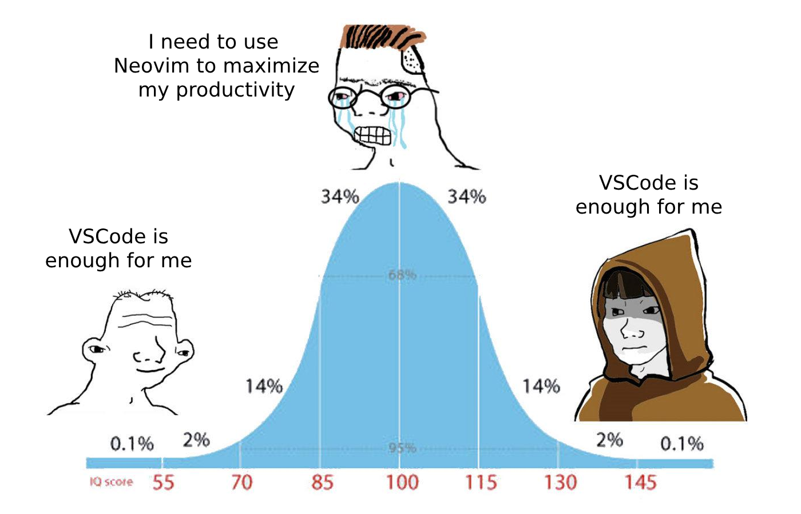
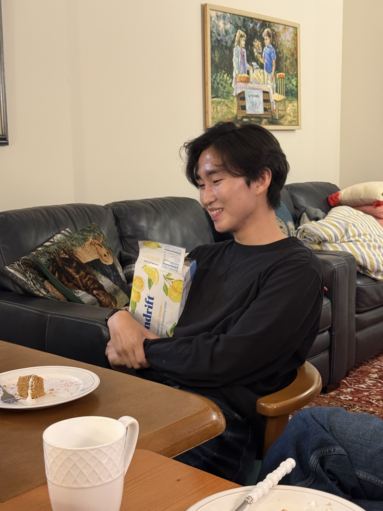
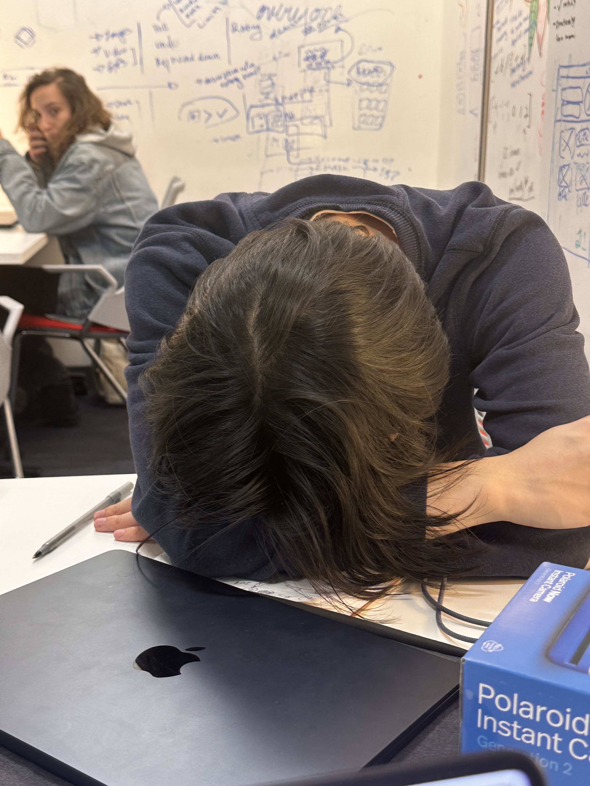
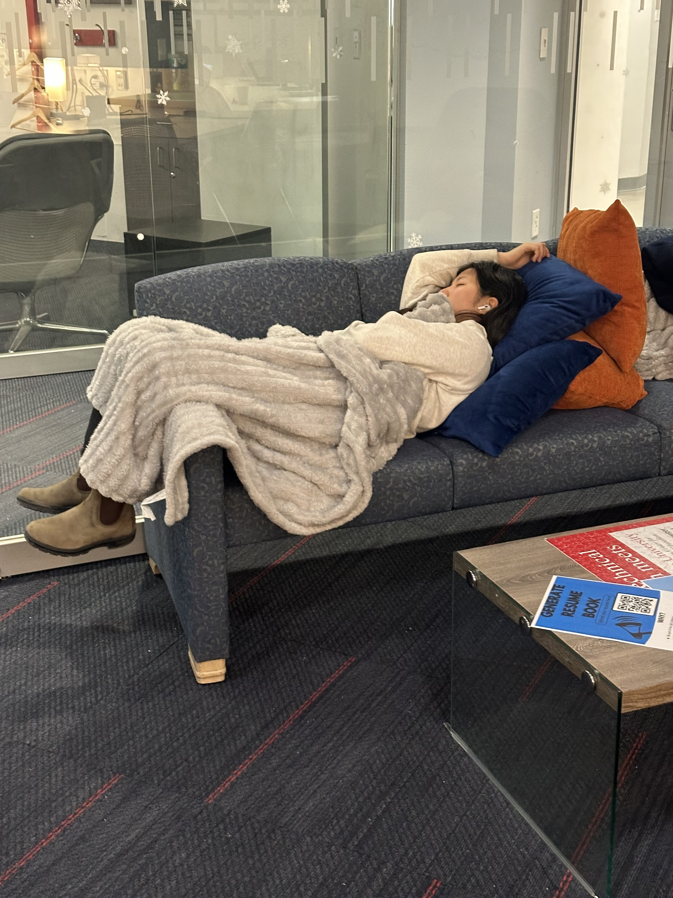
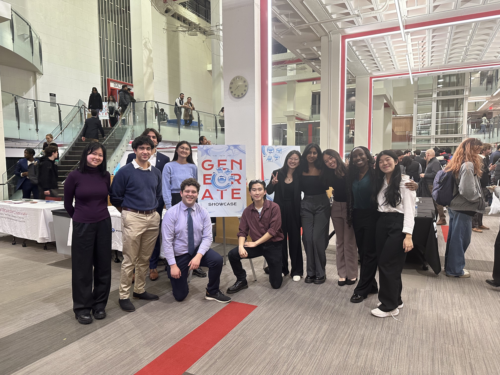

# THE (Neo)VIM Workshop - Presented by Stone Liu

Welcome to **The** VIM workshop.

<!-- stop -->


When will it end?
<!-- stop -->

VIM, otherwise known as (VI) Improved is a modal based editor known for its speed, efficiency, and most importantly...

<!-- stop -->
 aura.
# Stone


<!-- stop -->
1. I like VIM
<!-- stop -->
2. I like spindrift
<!-- stop -->
3. I also have been in _Generate_ for about $5$ semesters.
# Stone Sleep

# Melody Sleep

# Josh and Stone

# Snapper

# Couplet

# The plan

1. Modes: the one big idea
2. Motions: moving without a mouse
3. The grammar: Vim is a *language*
4. Power moves: the dot, search, macros
5. Vim Golf (there are treats)
6. Why any of this matters

<!-- stop -->

Laptops out. Open any file in `vim`, or turn on Vim mode in your editor.

# Lesson 0: how to leave

```
:q      quit
:q!     quit, and I mean it (throw away changes)
:wq     write, then quit
```

<!-- stop -->

You are now ahead of a statistically significant number of developers.

# Why Vim?

Not because it's old. Because the *ideas* travel.

<!-- stop -->

- VS Code: **VSCodeVim**
- JetBrains: **IdeaVim**
- Chrome / Firefox: **Vimium**
- Your shell: `set -o vi`
- `less`, `man`, `htop`: `j` `k` `/` already work

<!-- stop -->

You aren't learning an editor. You're learning a keyboard language you can take anywhere.

# Modes

Most editors have one mode: typing.

Vim has a few, and **Normal mode is home.**

```
Normal    move, delete, change, copy     <- you live here
Insert    type text                      i to enter, <Esc> to leave
Visual    select text                    v, V, <C-v>
Command   :w  :q  :s  :g                 :
```

<!-- stop -->

In Normal mode, your whole keyboard is a shortcut, and none of them need Ctrl.

<!-- stop -->

Ways into Insert mode, each with a reason:

```
i  insert before cursor      a  append after cursor
I  insert at line start      A  Append at line end
o  open a line below         O  Open a line above
```

Practice: `:Practice 01-modes`

# Moving around

```
h j k l    left down up right       (j hangs down like an arrow)
w b e      word, back, end
0 $        start of line, end of line
gg G       top of file, bottom of file
```

<!-- stop -->

Every motion takes a count:

```
5j     down 5 lines
3w     forward 3 words
```

<!-- stop -->

Turn on `relativenumber` and every line tells you its own count.

Practice: `:Practice 02-motions`

# Wait. It's a language.

<!-- stop -->

```
verb  +  count  +  noun
 d         2        w        "delete two words"
```

<!-- stop -->

**Verbs**

```
d  delete     c  change     y  yank (copy)     p  put (paste)
```

<!-- stop -->

**Nouns** are every motion you just learned.

<!-- stop -->

Learn 1 new verb and it works with every noun you know.
Learn 1 new noun and it works with every verb you know.

**That's why Vim users get faster every year.**

# Say it out loud

```
dw     delete word
d$     delete to end of line
c3w    change 3 words
dgg    delete to the top of the file
yy     yank the line          (doubled verb = whole line)
dd     delete the line
```

<!-- stop -->

Undo: `u`     Redo: `<C-r>`

Practice: `:Practice 03-grammar`

# Text objects

The mnemonic that makes Vim click:

```
i  =  inside
a  =  around
```

<!-- stop -->

```
ciw    change inside word
ci"    change inside quotes
da(    delete around parens
di{    delete inside braces
cit    change inside tag
yap    yank a paragraph
```

<!-- stop -->

Your cursor only has to be *somewhere inside*. No precise clicking or dragging.

Practice: `:Practice 04-text-objects`

# Find and till

```
f,     find the next ,
t,     go till (just before) the next ,
;      do it again
```

<!-- stop -->

Now stack it with a verb:

```
dt,    delete till comma
ct)    change till close paren
```

Practice: `:Practice 05-find`

# The dot

`.` repeats your last change.

<!-- stop -->

```
ciwfoo<Esc>     change a word to "foo"
n               jump to the next match
.               do it again
```

<!-- stop -->

This is why "change" is one command and not "delete, then type".
Your whole edit becomes a single thing you can repeat.

# Search

```
/word     search forward          ?word    search backward
n  N      next, previous match
*         search for the word under the cursor
```

<!-- stop -->

`*` + `ciw` + `n` + `.` lets you rename something everywhere and still look at each one.

# Macros

What if `.` could replay a *whole sequence*?

```
qa     start recording into register a
...    do anything
q      stop
@a     replay              30@a    replay 30 times
```

<!-- stop -->

Live demo: `:Practice 06-macros`

# Vim Golf

Turn the start text into the target in the **fewest keystrokes**.

The counter is watching. Fewest keys wins a treat.

<!-- stop -->

Round 1: `:Practice golf-1`       (par 15)

<!-- stop -->

Round 2: `:Practice golf-2`       (par 8)

<!-- stop -->

Round 3: `:Practice golf-3`       (par 5. Yes, five.)

# Golf answers

```
Round 1:   ci"goodbye moon            text object
Round 2:   :g/^D/d<CR>                :g runs a command on every match
Round 3:   jVGg<C-a>                  g<C-a> counts up across a selection
```

<!-- stop -->

None of these were tricks. They're the same grammar, applied once more.

# Why learn your tools?

<!-- stop -->

You will spend **more time editing code than writing it.**

<!-- stop -->

A tool you don't understand slows you down every day, and you won't notice.

A tool you *do* understand gets faster every year.

<!-- stop -->

Vim is small pieces that compose. That's also what good software looks like.

# This isn't about Vim

Use whatever editor you want.

<!-- stop -->

Just don't let it be a black box.

<!-- stop -->

Spend 10 minutes a week learning one thing it does that you didn't know.

That adds up to weeks of your life by the time you graduate.

# Take it home

```
vimtutor          ships with Vim, 30 minutes, start tonight
:help             the best manual you've never read
:help text-objects
```

<!-- stop -->

Week 1: just motions. Week 2: the grammar. Week 3: text objects. Week 4: the dot.

<!-- stop -->

When you hit your first `ci"` without thinking, it's too late. You're one of us.

# :wq

Questions?

<!-- stop -->

This whole presentation was Vim the entire time.
